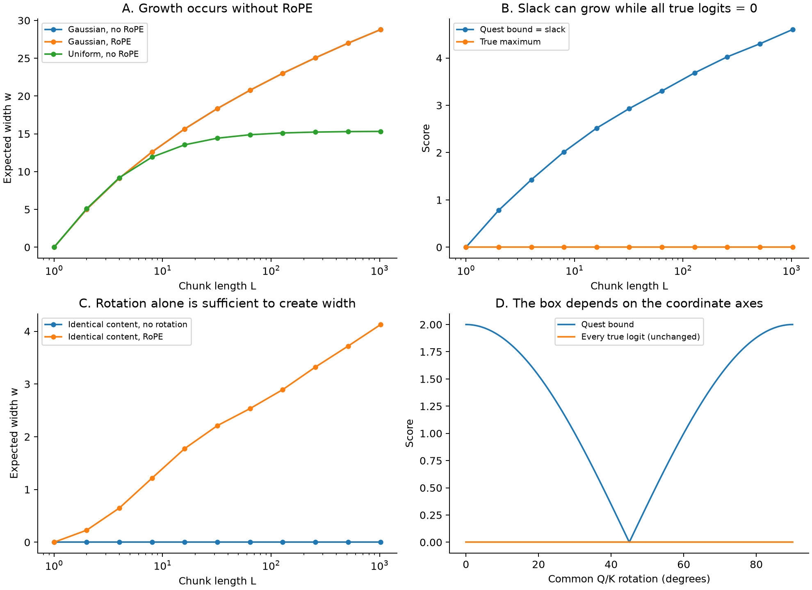
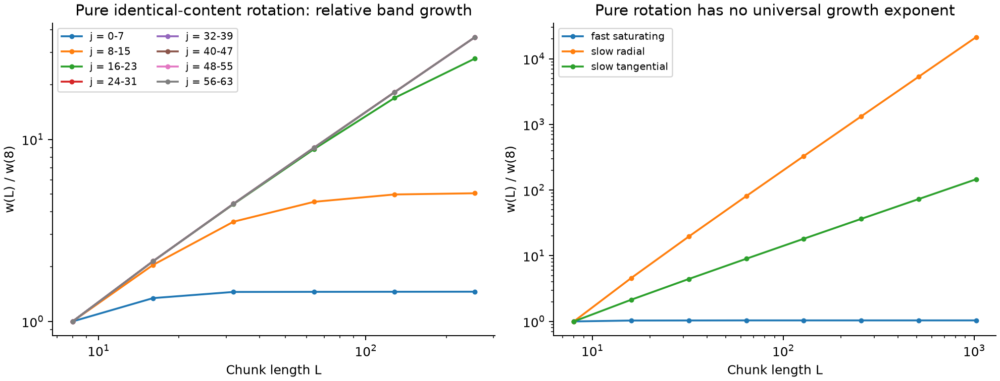

# Quest / RoPE mechanism audit and controlled counterexamples

Date: 2026-09-15. Scope: §2.1–2.7 of `browser-use/simulator/reports/2026-09-11_anchor_exponent_study.zh.md`, plus bounded synthetic experiments. These experiments do not estimate causal effect sizes in a trained model; they establish which proposed mechanisms are mathematically necessary, possible, or unidentified by the reported observations.

**Main conclusion.** Quest width growth needs neither RoPE nor growth of the true maximum. RoPE alone can create width from identical pre-rotation keys, but its contribution depends on content anisotropy, frequency, phase, query direction, and sampling. The existing report supplies a plausible local explanation and useful empirical calibration; its frequency-band measurements do not establish that RoPE causes the observed excess growth, or that `α ≈ .25` is universal.

## 1. What is provable

For a fixed query `q` and a finite key set `K`, let coordinate minima/maxima be `m,M`, box midpoint `a=(M+m)/2`, and half-range `r=(M−m)/2`. Then

\[
B(q,K)=q^Ta+|q|^Tr=c+w\ge T(q,K)=\max_{k\in K}q^Tk.
\]

This is the support function of the axis-aligned bounding box. Its maximizing corner may combine coordinates attained by different tokens. This is the source of geometric slack `G=B−T≥0`; it is separate from an actual large token logit.

For nested sets `K₁⊂K₂`, with **the same query and coordinate system**, `w`, `B`, and `T` are nondecreasing. Neither the center term `c` nor the gap `G` must be monotone: a newly added real key can move the true maximum closer to the old box corner and decrease the gap. These monotonicities do not automatically compare different random windows or different queries. Merely duplicating keys increases token count but leaves `c,w,B,T` unchanged.

The score `c+f(L)w` with `0≤f<1` is generally **not an upper bound**. In one dimension with `q=1,K={0,2}`, `c=w=1,T=2`, whereas `c+.5w=1.5`. Length shrinkage is a ranking heuristic. It can be below Quest without becoming a tighter *valid* bound.

### Exact no-RoPE Gaussian law

Suppose keys are independent `N(μ,σ²I)` samples, `q` is fixed, and `a_L=E[max₁…L Z_i]` for iid standard normals. Symmetry gives

\[
E[c]=q^T\mu,\quad E[w]=\sigma\|q\|_1 a_L,
\quad E[T]=q^T\mu+\sigma\|q\|_2 a_L,
\quad E[G]=\sigma(\|q\|_1-\|q\|_2)a_L.
\]

Thus sample extrema, true maximum, and box slack can all grow without any positions or RoPE. For large `L`, `a_L ∼ √(2 ln L)`; this is asymptotic, not a precise finite-range law. The **range** has expectation `2a_L` (the report's prose omits the factor 2 when describing its scale, though its Monte Carlo table is consistent with it). A power fitted over a short length range has a range-dependent slope. `√ln L`, `a+b ln L`, and a power can resemble each other across six finite points without becoming the same asymptotic law.

More generally, for independent multivariate Gaussian keys with covariance `Σ`,

\[
E[w]=a_L\sum_d|q_d|\sqrt{\Sigma_{dd}},\qquad
E[T]-q^T\mu=a_L\sqrt{q^T\Sigma q}.
\]

Off-diagonal correlations can strongly change true maxima while the expected coordinate width is unchanged. This is why independent-coordinate extremes and useful attention evidence must not be conflated.

### A stronger 2D counterexample: increasing slack, constant true logits

Let `k_i=(x_i,−x_i)` and `q=(1,1)`. Every true logit is exactly zero. Nevertheless,

\[
c=0,\quad B=w=\max_i x_i-\min_i x_i.
\]

If more iid Gaussian `x_i` are added, this width increases in expectation; there is no RoPE and no growth in attention-logit maxima. The box invents an impossible corner off the line `y=−x`.

For the concrete two-token set `{(1,−1),(−1,1)}`, `B=2,T=0`. Apply the same 45° orthogonal rotation to **both** keys and query:

\[
K'=\{(\sqrt2,0),(-\sqrt2,0)\},\qquad q'=(0,\sqrt2).
\]

Every dot product remains zero, but the new box gives `B'=0`. The entire slack vanished without changing any true attention score.

## 2. What RoPE can do, and what it cannot prove

Write one pre-rotation key pair as `x=r(cos φ,sin φ)`. At position `p`, the pair becomes

\[
k_p=r(\cos(\phi+\theta p),\sin(\phi+\theta p)).
\]

For identical content across positions, rotation alone now produces coordinate ranges. For a fixed query pair,

\[
w_{pair}=\tfrac12\big[|q_x|\operatorname{range}(r\cos(\phi+\theta p))
+|q_y|\operatorname{range}(r\sin(\phi+\theta p))\big].
\]

The relevant span for `L` consecutive integer positions is `Δ=θ(L−1)`, not exactly `θL`.

- Small `Δ`: a generic tangential coordinate changes linearly, `w=O(r|q|Δ)`.
- At a stationary point of a coordinate, its range can be quadratic, `O(r|q|Δ²)`. A query that selects just that coordinate exposes this behavior.
- Large coverage: each coordinate range is bounded by `2r`; a pair's width is at most `r(|q_x|+|q_y|)`. Pure rotation of fixed content ultimately saturates rather than growing logarithmically forever. Discrete phase coverage and starting phase matter.

A small example with actual angular increment below 1 rad is `x=(1,0), θ=π/4, q=(1,1)/√2`. For the three positions `0,1,2`, the keys are `(1,0),(1/√2,1/√2),(0,1)`. True maximum is `1`, while the box bound is `√2`. For the first token alone the width is `0`; for all three it is `1/√2`. Rotation is sufficient to create both coordinate width and box slack from identical content.

### Why the observed middle-band peak is suggestive, not a causal test

The report uses `θ_j=(5×10⁶)^(−j/64)` and `D=128`. Representative actual spans are:

| Pair j | θ per token | Span at L=8 | Span at L=256 | Full-circle period |
|---|---:|---:|---:|---:|
| 0 | 1 | 7 | 255 | 6.28 |
| 7 | .18505 | 1.295 | 47.189 | 33.95 |
| 8 | .14542 | 1.018 | 37.083 | 43.21 |
| 15 | .026911 | .1884 | 6.862 | 233.48 |
| 16 | .021147 | .1480 | 5.393 | 297.11 |
| 23 | .0039134 | .02739 | .9979 | 1605.54 |
| 32 | .00044721 | .003131 | .1140 | 14049.63 |
| 63 | 2.5451e−7 | 1.7816e−6 | 6.4900e−5 | 2.469e7 |

Thus the report's label “j=0–7 already saturated at L=8” is too strong: pair 7 covers only 1.30 rad across eight positions. A span exceeding 1 rad is not a completed circle. Mid-band transitions are a sensible place to expect an **additional absolute contribution** from rotation while higher bands approach their coverage ceiling and lower bands move little in absolute value.

However, dimensions differ in pre-RoPE variance, correlations, phase, semantics, and query weight. Comparing post-RoPE bands does not hold those fixed. Low-frequency growth alone does not diagnose “slow drift”; iid non-Gaussian tails, finite-range statistics, dependence, and position-dependent content mixtures are alternatives. Real contiguous text changes both token count and physical span together.

Our identical-content experiment also clarifies a subtlety: the lowest bands have the **largest relative growth** (`w256/w8 ≈ 36.43`, approximately `(256−1)/(8−1)`) because they are still linear, but contribute almost no absolute width. Band 56–63 grows from `2.41e−6` to `8.79e−5`, while band 0–7 grows from `1.0168` to `1.4810`. A middle-band maximum in a *relative exponent* is not a universal signature of RoPE. It arises from the mixture of rotation with a nonzero content-driven width baseline and frequency-dependent amplitudes/weights.

### An exact null: iid isotropic Gaussian content

If `x_p` are independent `N(0,I)` and `R_p` are arbitrary deterministic orthogonal rotations, then the entire sequence `{R_p x_p}` has exactly the same joint distribution as `{x_p}`. For any fixed query, every expected box or logit statistic is therefore unchanged by per-token RoPE. RoPE does not mechanically add another positive width term to arbitrary content. On a particular sample, it can increase or decrease width; only an appropriate paired intervention can quantify the effect in a trained model.

## 3. Executed controls

Script: [synthetic_controls.py](synthetic_controls.py). Runtime: Python 3.11.15, NumPy 2.4.6, Matplotlib 3.11.2. Seed `20260915`; `512` independent repetitions; `D=128`; lengths `1,2,4,8,16,32,64,128,256,512,1024`. For Gaussian/uniform/identical-content cases, a **single fixed query** has `||q||₂=1`, `||q||₁=8.86450435`, and remains the same for every repetition and length. Lengths use nested prefixes. No `1/√D` is applied because the query was normalized; these are internally consistent synthetic score units, not model logits. The anti-correlated case uses normalized 2D `q`, while the exact rotation illustration uses unnormalized `(1,1)` to keep arithmetic simple.

| Condition | Mean w at 8 | Mean w at 256 | Fitted log-log slope, 8–256 | What it establishes |
|---|---:|---:|---:|---|
| iid Gaussian, no RoPE | 12.605821 | 25.053614 | .194242 | RoPE is unnecessary for width growth |
| Same Gaussian keys, per-token RoPE | 12.612065 | 25.053180 | .194231 | Agrees with exact distributional null |
| iid uniform, no RoPE | 11.926354 | 15.233924 | .065262 | Tail/support statistics change the slope |
| Anti-correlated 2D Gaussian, no RoPE | 2.015780 | 4.024870 | .194558 | True maximum is identically zero; all bound growth is slack |
| Identical content, no RoPE | 0 | 0 | undefined | Repetition alone does not expand a box |
| Identical content, per-token RoPE | 1.216221 | 3.321863 | .273024 | Rotation alone is sufficient to create growth |

The paired Gaussian RoPE-minus-no-RoPE width difference at `L=256` is `−.000434 ± .007249` (mean ± standard error), consistent with the exact zero expectation. The no-RoPE Gaussian true maximum increases `1.408701→2.836068`, while slack increases `11.183780→22.219370`. The corresponding anti-correlated true maximum is zero throughout.

For a single repeated 2D pair, holding query/content fixed and varying only the frequency/direction gives fitted width slopes `.008124` (fast and saturated), `1.034384` (slow tangential), and `2.068769` (slow radial). The slopes slightly exceed 1 and 2 because the fit uses `L` while the exact small-angle span is `L−1`. The common-rotation sweep changes the two-token bound continuously from 2 to 0 and back to 2; maximum measured true-logit change is exactly 0 in this computation.

The bounded uniform control has an exact expected width:

\[
E[w_L]=\sqrt3\,\|q\|_1\frac{L-1}{L+1},
\]

which saturates at `√3||q||₁`. Its exact `L=256` value is `15.234287`, close to the measured `15.233924`.





All values, standard errors, paired deltas, band measurements, and local slopes are in the adjacent CSV files. `run_metadata.json` records parameters and fitted slopes. Both figures were rendered and visually inspected; no clipping or overlaps were observed.

Reproduce from the workspace root:

```sh
/tmp/context-composition-venv/bin/python research/2026-09-15_rope_quest/mechanism/synthetic_controls.py
```

## 4. Proper interpretation of trained-model interventions

Assume the actual implementation writes `k_p=R_p x_p` and uses `q_t=R_t y_t` after any architecture-specific projection, normalization, and rotary layout. Recovering `x_p=R_p⁻¹k_p` is a valid local decomposition **only when the exact rotations and position IDs are known**.

1. **Paired pre-/post-RoPE width with the same fixed query.** Compare `B(q*,{x_p})` and `B(q*,{R_p x_p})`, using the same `q*` across conditions and lengths. This isolates the effect of the explicit key rotation on stored key geometry conditional on the realized layer inputs. Track `c,w,T,G`, since rotating keys can change true scores too.
2. **De-RoPE both keys and the actual query.** Compare actual logits `y_tᵀR_tᵀR_p x_p` with `y_tᵀx_p`. This removes the explicit relative-position factor *at that layer*, conditional on the original hidden states. It is a local attention counterfactual, not the behavior of a model trained or run without RoPE. Its query differs between pre/post conditions, so it should not replace the fixed-query key-geometry control.
3. **Common rotation, score-preserving control.** Choose one orthogonal `S` and transform `q→Sq`, every `k_p→Sk_p`. Then every true logit, softmax weight, mass, and exact density is invariant; only box geometry and its proxy rankings may change. A shared RoPE shift `S=R_δ` tests dependence on the arbitrary position origin/coordinate orientation. Arbitrary pairwise common rotations give a broader axis-alignment stress test. Recompute extrema from transformed **keys**; rotating the stored min/max vectors is not equivalent.
4. **Frozen-content sufficiency control.** Repeat an actual recovered key pair or full key at many positions, then apply real model frequencies. This removes token-content diversity. It shows a mechanism can operate at the actual frequencies; it does not estimate its share of natural-data growth.
5. **Separate count and span.** At fixed sample count, vary positional span using frozen content or controlled key subsets; at fixed span, vary the number of sampled positions. Use matched starting positions/content where possible. A contiguous-length sweep alone cannot separate the two.

For grouped-query attention, apply the same common rotation to all query heads sharing a key head, and compare each head's logits before averaging probabilities. Query averaging commutes with the common rotation, but softmax does not commute with query averaging. Verify invariance numerically before interpreting box differences. A common rotation with unchanged values preserves the attention-weighted value result as well.

At later layers, recovered `x_p` already depends on earlier attention, positions, and the original model's learned adaptation to RoPE. A local inverse rotation leaves those pathways intact. Attribution to the **entire trained architecture** would need broader interventions or retraining and must not be inferred from a cache-only operation. Exact implementation details may include rotary pairing layout, partial rotary dimensions, multimodal position IDs, scaling/interpolation, normalization order, and finite precision.

## 5. Mass, token budget, and ranking confounds

For one fixed query head, let scaled logits be `z_i` and global dense softmax denominator `Z`. A chunk's mass and density satisfy

\[
P_C=\frac{\sum_{i\in C}e^{z_i}}Z,\qquad
\log(P_C/L)=\operatorname{LSE}(z_C)-\log L-\log Z.
\]

This is the exact density score up to a query-wide constant. Neither the true maximum nor the box center equals it. If `T=max z_i`, then

\[
T-\log L\le \log\big(\tfrac1L\sum_i e^{z_i}\big)\le T.
\]

Thus `T−ln L`, called an oracle row in the report, is a lower bound/proxy for log density, not oracle density itself. Expected density is length independent only under appropriate stationary sampling; a realized density can change with length/content, and the **mean log density** has finite-sample effects even when mean unnormalized density is constant.

For fixed dense token masses, indivisible chunk selection with a hard token budget is a **0–1 knapsack**, for which density sorting is a heuristic. It is exact for the fractional relaxation. Counterexample: budget 10, one chunk `(length,mass)=(6,.12)` and two chunks `(5,.095)` each. Density sorting takes `.12`; taking the two length-5 chunks gives `.19`. Floors, mandatory tokens, overshoot/skip admission, and overlap rules add constraints. The density interpretation remains useful, but does not establish an optimal admission rule.

Also, retained dense attention mass is a proxy for model output quality: values, head specialization, and renormalization matter. Region-aware lengths encode DOM/system/history priors; failure-conditioned dumps, layer mix, region mix, and query mix can all affect pooled correlations and the empirically best exponent. Equal-size chunks remove the *between-chunk cost* difference, but do not make box slack harmless or prove Quest scores are correctly calibrated.

The report's grouped `q̄` bound is valid for `q̄ᵀk`; it does not upper-bound every member query head separately. Averaging logits across heads and then exponentiating is not averaging per-head attention probabilities. Large `exp(B−T)` values correctly describe the multiplicative looseness of an exponentiated bound for that same logit, but should not be interpreted directly as an error factor in mean attention mass.

## 6. Corrections to the report's strongest statements

| Report claim | Assessment / precise replacement |
|---|---|
| The Quest identity is a support-function upper bound (§2.1) | Correct for the query used to build the score. |
| Budgeted selection should greedily rank density (§2.2) | Correct for fractional knapsack; a heuristic for indivisible chunks and constrained admission. |
| `c` does not depend on length and is effectively centroid-like (§2.3/2.7) | An empirical observation here, or a consequence of central symmetry in expectation. A box midpoint is not a sample mean. |
| `w` is logarithmic; power .245 is its local approximation (§2.3) | Report as a finite-range fitted curve. Six points and <2% residuals do not identify the asymptotic law. `w(1)=0` exactly, so `17+47.6 ln L` cannot hold at L=1. |
| Mid-frequency growth proves added RoPE expansion (§2.4) | Consistent with the mechanism, but a frequency-band association does not isolate it. Paired de-RoPE and score-preserving controls are needed. |
| High-frequency band is saturated at L=8 (§2.4) | Not all pairs: j=7 spans only 1.30 rad. Saturation also depends on phase coverage/content. |
| Low-frequency exponent > iid proves content drift (§2.4) | Not identified. Tail shape, dependence, content mixture, and finite-range estimates are alternatives. |
| β≈.25 is key geometry, not web-agent data (§2.4) | Learned key geometry includes the data distribution and model processing. Similar slopes across several related models support limited robustness, not universality or data independence. |
| Matching mean width slope makes α=β optimal | It can flatten `E[w|L]` under the fitted model. It does not prove optimal mass capture, ranking, or online action accuracy; λ and region priors interact. |
| A only changes overall width weight for fixed α (§2.5) | Correct: `λ=A^α`. Per-prompt mean/median A also changes λ across prompts, so it is a limited prompt adaptation, although not block-specific adaptation within a prompt. |
| Two distinct lengths imply unique equivalent `(A,α)` (§2.5) | Requires α≠0 and at least two informative lengths with nonzero possible width. If α=0, A is unidentifiable. If lengths are `{1,L₀}`, width at 1 is always zero, leaving only one informative factor. |
| Equal-length chunks make equal λ equivalent (§2.5) | Need equal `f(L₀)=λL₀^(−α)`, not merely equal λ when α changes. A constant width multiplier can still change ranking relative to c. |
| Equal standard deviations identify contribution to ranking (§2.5) | A useful scale heuristic, not a decomposition. `Var(c+λu)=Var(c)+λ²Var(u)+2λCov(c,u)`; ranks additionally depend on pairwise orderings. |
| Length correction is also a region prior (§2.6) | Correct and an essential confound to preserve in interpretation. |

An exact counterexample to universal length-independent center: in 1D, `q=1` and iid exponential keys of mean 1 give

\[
E[(M+m)/2]=\tfrac12(H_L+1/L),\quad E[\bar k]=1.
\]

Expected midpoint rises from `1.4214` at L=8 to `3.0641` at L=256; the centroid expectation stays 1. This directly distinguishes the box center from a mean without any positional encoding.

For §2.5, a corrected equivalence theorem is: if scores must agree in ranking for every admissible key/query construction at **two distinct lengths ≥2**, the center coefficient is fixed at 1, widths can vary, anchors are positive, and α is nonzero, then equality of both factors implies identical α and A. If α=0, all anchors produce `f=1`. With only lengths `{1,16}`, every `(A=16,α)` gives exactly the same scores because `w(1)=0` and `f(16)=1`.

## 7. Recommended language for the explanation

“Longer chunks tend to expose more coordinate extrema. Quest combines these extrema into a box corner that may not correspond to any token, so both sample-size effects and box slack can favor long chunks. RoPE can contribute by rotating otherwise similar keys over the positional span, especially where that span changes from a short arc to broad phase coverage. In our measured model/data range, the resulting width was well fitted by a local exponent near .25; this is an empirical normalization choice, not a universal RoPE law. Because chunk length also tracks region and token cost, success of the normalization does not by itself establish which mechanism caused the improvement.”

The strongest causal evidence would be a paired real-KV analysis showing how much width and gap change when explicit rotations are removed with the content and query controlled, alongside a common-rotation experiment demonstrating changes in the proxy while true attention is held exactly fixed.
