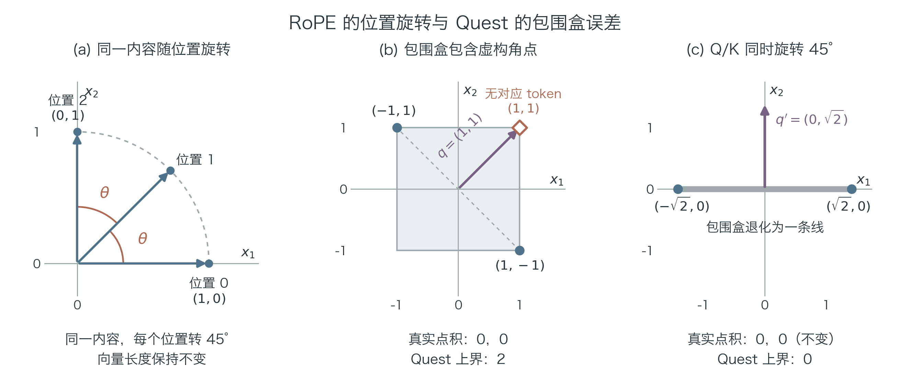
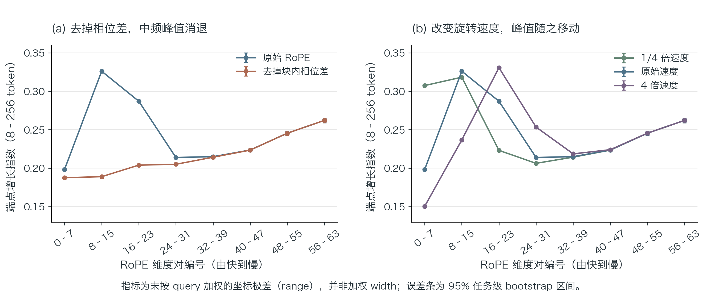

# RoPE 与 Quest 的长度偏差

三页中文研究简报 | 2026 年 9 月 15 日

**简短结论：原报告的中频旋转机制得到实验支持，但它不能解释全部长度偏差。** 在已记录的模型表示上，消除 chunk 内的显式旋转差异，使长度为 256 tokens 的 chunk 的 Quest 上界误差下降 **8.65%**，但大部分误差及其长度效应仍然存在。**0.25 在本次离线诊断中是有效的经验校准值，不是 RoPE 的普适定律。** 相关机制也已有明确的论文先例。

## 1. RoPE 做了什么，Quest 为什么会高估？

**token** 是模型处理的文本单元，可以是字、词或词的一部分。**chunk** 是连续的一组 tokens，下文也称“块”。Attention 可以理解为一次检索：**query（Q）** 表示当前位置想找什么，**key（K）** 表示已有 token 能与什么匹配。模型计算 Q 与各个 K 的缩放点积，得到 **logit**，再通过 softmax 转成 attention 权重，用这些权重汇总 value。Sparse attention 则只选择部分 K/V，以减少计算和内存访问。

**RoPE 是 Rotary Position Embedding，即旋转位置编码。** 它把 Q/K 向量中的数值两两配对，再按 token 的位置旋转。把一对数值看成平面上的箭头：`(1, 0)` 旋转 45 度后约为 `(0.707, 0.707)`，旋转 90 度后变成 `(0, 1)`。箭头长度不变，坐标却发生了变化。Q 和 K 都按各自位置旋转后，两者的点积便能反映**相对位置**。这是 [RoFormer](https://arxiv.org/pdf/2104.09864v5) 提出的基本构造。

不同数值对采用不同旋转速度。这里的 **frequency（频率）** 指每前进一个 token 转过多少弧度，**phase（相位）** 指某个位置对应的旋转角度。高频数值对在较短 chunk 内就可能转过较大范围，低频数值对几乎不动。中频数值对则可能随着 chunk 变长，从一小段圆弧扩展到较宽的角度范围，让原本相似的 keys 在坐标上更加分散。RoPE 保持单个向量的长度不变，也不保证每个 attention score 都随距离单调下降。

*图 1：位置旋转改变 key 的坐标。Quest 的包围盒可能包含没有任何 token 对应的角点。对全部 Q/K 做相同旋转，真实分数不变，上界误差却可能改变。*

Quest 为每个 chunk 保存各坐标的最小值和最大值，形成一个与坐标轴平行的**包围盒（bounding box）**。打分时，它组合各坐标上最有利于 query 的极值。极值可能来自不同 token，因此盒子角点未必对应真实 key。

例如，两个 keys 为 `(1, -1)` 和 `(-1, 1)`，query 为 `(1, 1)`。两个真实点积都是 0，但包围盒包含角点 `(1, 1)`，Quest 给出的上界便是 2。**上界在数学上没有错，却可能高估 chunk 的实际相关性。** 为方便手算，这个例子省略了统一的 attention 缩放系数，真实模型实验保留了该系数。

Quest 分数可以拆成 **U = c + w**：c 是 query 与盒子中点的点积项，w 是经过 query 加权的半宽度项。真正的上界误差是 **G = U - T**，其中 T 是 chunk 内最大的真实 logit。**宽度 w 不等于误差 G。** 即使没有 RoPE，较长 chunk 也更容易收集到极端坐标，同时还要占用更多 token 预算。这是混合 chunk 长度时需要校准分数的基本原因。

<!-- pagebreak -->

## 2. 实验究竟支持什么结论？

我们使用 Qwen3-VL-30B-A3B-Instruct 的 **23 份模型记录（capture），覆盖 21 个不同输入（prompt）、13 个任务**，检查四层，每层取三个已记录的 query。这些记录来自筛选出的 web-agent 差异案例，不能视作随机任务样本。实验固定 sparse decoding 轨迹中的 query，针对输入处理阶段（prefill）保存的 keys 计算 attention，并在不同条件下使用相同的采样窗口和 chunk 长度。

核心干预是：把 chunk 内每个 key 都旋转回第一个 key 的位置相位，**消除当前层中显式的 chunk 内相位差异**，同时保持该层已记录的内容向量和各 key 的长度不变。由于改变 key 的旋转也会改变真实匹配分数，每次干预后都会重新计算 T，进而检查误差 G，而不只比较宽度 w。

| 指标（采用 pooled query） | 原始状态 | 消除 chunk 内相位差异 |
|---|---:|---:|
| 256 tokens 时的宽度 w | 24.701 | 22.836 |
| 256 tokens 时的误差 G | 19.589 | 17.894 |
| 8-256 tokens 区间的宽度拟合指数 | 0.2500 | 0.2377 |

pooled query 指先平均共享同一 KV head 的 query heads，再计算分数。拟合指数概括宽度随长度增长的速度，数值越大，增长越快。干预后，宽度下降 **7.55%**，误差下降 **8.65%**，后者的 95% 置信区间为 **8.45%-8.91%**。分别计算全部 32 个 query heads 时，误差也下降了 9.91%。因此，RoPE 的影响确实存在，但消除这部分旋转后，大部分长度效应仍然存在。置信区间按任务成对重采样 5,000 次（paired bootstrap），13 个任务等权，未对多项比较进行校正。

**中频机制获得了直接支持。** 该模型每个注意力头有 64 对数值，按旋转速度从快到慢编号为 0-63。消除相位差异后，数值对 8-15 的极差增长指数从 0.326 降至 0.189，数值对 16-23 从 0.287 降至 0.204。改变旋转速度还会移动增长峰值所在的频带，而最慢的频带几乎不变。这比“不同频带恰好呈现不同增长速度”的相关性观察更能支持旋转机制。

*图 2：消除相位差异会削弱中频峰值，改变旋转速度会移动峰值。这里测量的是未经过 query 加权的坐标极差，指数由 8 和 256 tokens 两个端点计算。误差棒为 task bootstrap 区间。*

**没有 RoPE，也会出现同类高估。** 合成实验让每个 key 都形如 `(x, -x)`，query 与 `(1, 1)` 同方向。所有真实分数始终为 0，但 Quest 包围盒的平均宽度和上界仍会随样本数增长。反过来，把完全相同的内容向量放到不同位置再施加 RoPE，也能从零宽度产生非零宽度。这说明 RoPE 可以造成该现象，却不是必要条件。

**0.25 不能当作普适常数。** 原始真实数据中，8-16 tokens 的局部指数为 0.386，128-256 tokens 时降至 0.166。0.25 只是有限区间内的拟合值。另外，这次干预不等于重新训练或运行一个完全没有 RoPE 的模型。更早层的位置信息仍保留在当前表示中，剩余误差不能全部归为“与位置无关的内容”。

<!-- pagebreak -->

## 3. 对 chunk 选择和论文判断意味着什么？

另一组对照对所有 Q/K 施加**同一个旋转**。共同旋转会在点积中抵消，因此所有真实 logits 和 attention 权重都不变，Quest 选出的 chunks 却会改变。在相当于 4093 个位置的共同旋转下，新旧选择的 token 集合 Jaccard 重合度为 **0.888**，1 才表示完全相同。按真实 attention density 选择的结果则在全部 1,656 个对照单元中保持一致。这说明：**即使真实相关性不变，坐标方向也会影响 Quest 的代理分数和选择结果。**

在原有变长 chunk 边界上，我们比较了原始 Quest 与长度校准分数 **c + (16/L)^0.25 w**。这里 L 是 chunk 的 token 数。当 L>16 时，宽度项会缩小，分数可能低于真实最大 logit，因此校准后不再保证为上界，而是用于排序的启发式。使用相同的 **2,048 tokens 的预算**和整块准入规则，保留的 prefill attention mass 从 **64.16% 提高到 76.21%**，增加 **12.05 个百分点**，配对 95% 区间为 10.65-13.35 个百分点。attention mass 指所选 tokens 的 attention 权重之和。按真实 **density（每 token 的 attention mass）** 做贪心选择（greedy）的参考结果为 81.11%。

这支持长度校准在当前离线设置中的实用性，但不能证明全部收益都来自修正 RoPE，也不是 web-agent 任务成功率的提升。实验使用存档 chunk 边界，没有重新运行后来的 DOM/hybrid parser，也没有强制保留 system 或最近 tokens。各方法都按分数从高到低纳入整个 chunk，放不下就跳过。面对变长且不可拆分的 chunks，按 density 贪心选择是参考启发式，不保证最优。

### 相关问题，其他论文确实注意过

| 论文 | 与本问题直接相关的发现 |
|---|---|
| [ArkVale，NeurIPS 2024](https://proceedings.neurips.cc/paper_files/paper/2024/file/cd4b49379efac6e84186a3ffce108c37-Paper-Conference.pdf)，§§5.2、6.2 | 缩小 cuboid 的半径以减少重要性高估，允许分数不再是严格上界，从而改善检索。这是宽度收缩的直接先例。 |
| [LServe，2025](https://arxiv.org/pdf/2502.14866v2)，§3.5 | 更大的 page 会削弱 Quest 统计量的代表性。通过小 logical pages 和分层评分缓解该问题。 |
| [Loki，2024](https://arxiv.org/pdf/2406.02542v1)，§§3、5.2 | RoPE 会改变 key 集合的几何形态和内在维度，影响 sparse selection 所用的近似表示。 |
| [SALS，NeurIPS 2025](https://papers.neurips.cc/paper_files/paper/2025/file/00a0ebcad584c59dbc439c2af8793638-Paper-Conference.pdf)，§§3.1、4.2-4.3 | 分析 RoPE 后 key 集合的方差扩张，并研究在不含 RoPE 的 latent space 中筛选 tokens。 |
| [FASA，ICLR 2026](https://arxiv.org/pdf/2602.03152v3)，§§3、4.1 | 不同 RoPE 频率对预测重要 tokens 的贡献不同，可利用频带选择进行稀疏化。 |

因此，“此前没有人发现 RoPE 或大块摘要存在这些问题”这一宽泛的新颖性判断不成立。本轮阅读的论文中，没有找到完全相同的“混合 chunk 长度 + 对 Quest 宽度项显式做长度校准”的组合，但**没有检索到，并不等于证明首次提出**。

**更稳妥的解释是：semantic chunking 带来了不同的 token 成本，而 Quest 的坐标极值分数需要针对这些成本进行经验校准。RoPE 是其中一个可测量的几何因素。** 0.25 可以是实用的参数，却不是理论常数。评估评分方法时，ArkVale 和 LServe 尤其值得作为对照。

来源审计还发现，历史报告中一张宽度表与保存的四个 prompt 的脚本相符，而不是文字所称的 23 个 prompt 的设置。新实验明确覆盖全部 23 份模型记录，并复现了主要趋势。完整方法、数据和 16 篇论文的核查见[详细报告](report.md)。本中文版独立保存，未修改论文或 Overleaf 文件。
